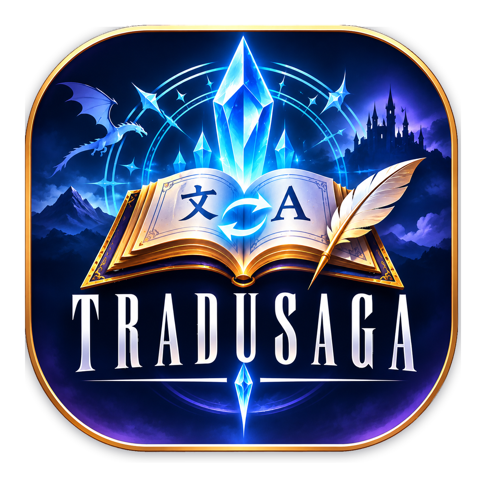
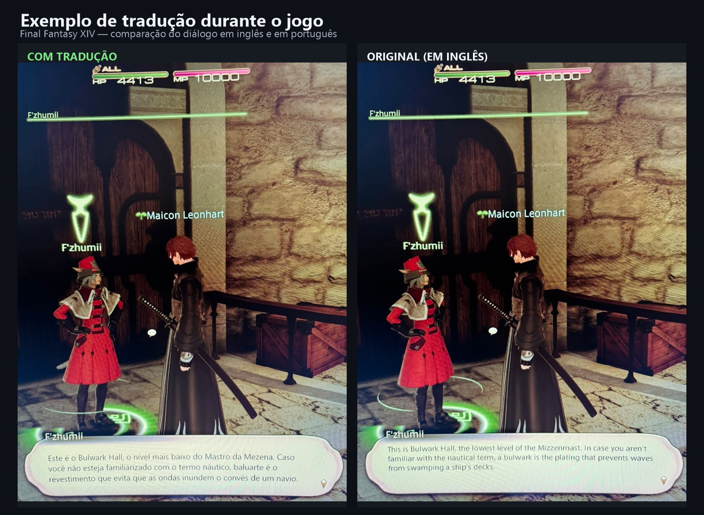

  

# TraduSaga

**Porque nenhuma grande história deveria ser perdida na tradução.**

O TraduSaga é uma ferramenta para traduzir texto de RPGs reconhecido na tela e exibir o resultado em uma janela sobreposta. O projeto busca ajudar jogadores a acompanhar diálogos, missões e histórias mesmo quando não dominam o idioma original. Sua proposta é funcionar sem exigir alterações nos arquivos originais dos jogos; os recursos disponíveis dependem das capacidades e da configuração do aplicativo.

Tudo começou quando eu estava jogando *Final Fantasy XIV*: mesmo com inglês avançado, eu sentia dificuldade para compreender plenamente a narrativa. Depois de procurar uma ferramenta que atendesse a essa necessidade e não encontrar, decidi criar uma solução inicialmente para uso pessoal. [Leia a história completa do TraduSaga](docs/HISTORIA-DO-PROJETO.md).

O TraduSaga é um aplicativo Windows em C#/.NET. Inclui captura de tela, reconhecimento óptico de caracteres (OCR), tradução por provedores externos selecionáveis e leitura em voz alta opcional.

## Exemplo em jogo

A montagem compara o diálogo original em inglês com a versão em português durante uma partida de *Final Fantasy XIV*.

  

**Assinatura:** o projeto está em processo de submissão à SignPath Foundation. Não há workflow de assinatura SignPath neste checkout; atualizaremos esta informação quando a submissão avançar e houver configuração ou aprovação confirmada.

## Funcionalidades

- Captura contínua da tela ou de uma área selecionada.
- Reconhecimento de texto por mecanismos OCR, incluindo Windows OCR e componentes OpenCV.
- Processamento local auxiliar para avaliar e filtrar o texto reconhecido.
- Tradução usando Google Translate, DeepL ou Yandex, conforme configuração e consentimento.
- Janela de tradução sobreposta, atalhos e suporte a entrada por controle.
- Leitura em voz alta usando recursos de TTS do Windows.

## Requisitos

- Windows 10 versão 2004 (build 19041) ou posterior, conforme o target do projeto.
- Arquitetura Windows x64.
- O pacote publicado deve incluir os modelos de previsão e as bibliotecas nativas necessárias.
- Recursos de idioma OCR/TTS do Windows podem ser necessários conforme os idiomas escolhidos.

## Instalação e utilização

O pacote oficial para Windows x64 está disponível na seção [Downloads](#downloads). Confira o release e o SHA-256 publicados antes de usar o arquivo.

A utilização prevista é selecionar os idiomas de origem e destino, escolher um provedor de tradução, conceder ou negar o envio de texto a esse provedor, configurar OCR/TTS e iniciar a captura e tradução. A interface pode solicitar autorização do Windows para instalar pacotes de idioma OCR/TTS; essa operação instala capacidades oficiais do Windows e requer elevação.

## Modelos de previsão

O build usa os cinco modelos `chi`, `eng`, `jap`, `kor` e `rus` versionados em `models/prediction` na raiz do projeto e os publica ao lado do aplicativo. As versões internas e os hashes SHA-256 estão em [models/prediction/README.md](models/prediction/README.md). Para usar outro diretório, informe `-p:TraduSagaPredictionModelsPath="CAMINHO\PARA\prediction"` ao executar `dotnet build` ou `dotnet publish`.

## Privacidade

Consulte [PRIVACY.md](PRIVACY.md). Em resumo, o OCR e a captura são realizados localmente; quando o usuário permite um provedor de tradução, o texto reconhecido é enviado ao serviço correspondente. O código revisado contém consentimento por provedor e permite alterar ou retirar essa permissão nas configurações.

## Segurança

Consulte [SECURITY.md](SECURITY.md) para reportar vulnerabilidades de forma responsável.

## Licença

O repositório contém Apache License 2.0. A licença do código-fonte não substitui as licenças de fontes, ícones, modelos, bibliotecas nativas e dependências de terceiros. Consulte o relatório [docs/SIGNPATH-READINESS.md](docs/SIGNPATH-READINESS.md).

Partes do TraduSaga foram adaptadas do [Translumo](https://github.com/ramjke/Translumo), de `ramjke`, distribuído sob Apache License 2.0.

## Assinatura de código

Não há workflow de assinatura SignPath no repositório deste checkout. O projeto está em processo de submissão; não descreva executáveis como assinados pela SignPath sem evidência da assinatura.

Após aprovação formal e configuração efetiva, atualize esta seção com a declaração aplicável e os responsáveis reais por autoria, revisão e aprovação, conforme orientação da Fundação. Consulte [docs/CODE-SIGNING-POLICY.md](docs/CODE-SIGNING-POLICY.md).

## Desenvolvimento

Consulte [CONTRIBUTING.md](CONTRIBUTING.md). O build usa .NET 8 e os arquivos `packages.lock.json` devem ser restaurados em modo bloqueado (`--locked-mode`).

## Downloads

Baixe a versão **TraduSaga 1.1.0 para Windows x64** pela [release no GitHub](https://github.com/maiconwiss/TraduSaga/releases/tag/v1.1.0) ou diretamente pelo [arquivo ZIP](https://github.com/maiconwiss/TraduSaga/releases/download/v1.1.0/TraduSaga-1.1.0-win-x64.zip).

SHA-256 do ZIP: `BF696AA5C48D7DB25F9FF1D8DCA747311843F7846298CC7D4EFF15AF29037091`.
